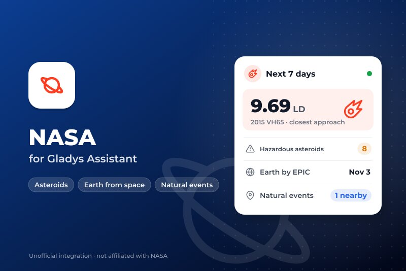
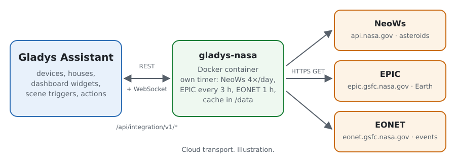
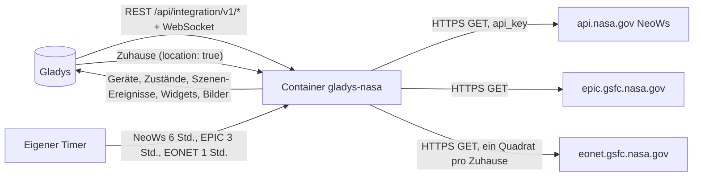
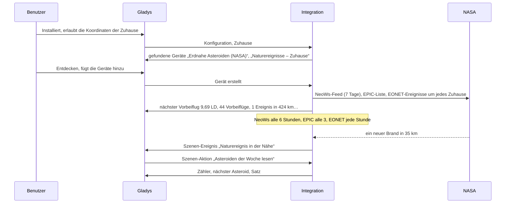
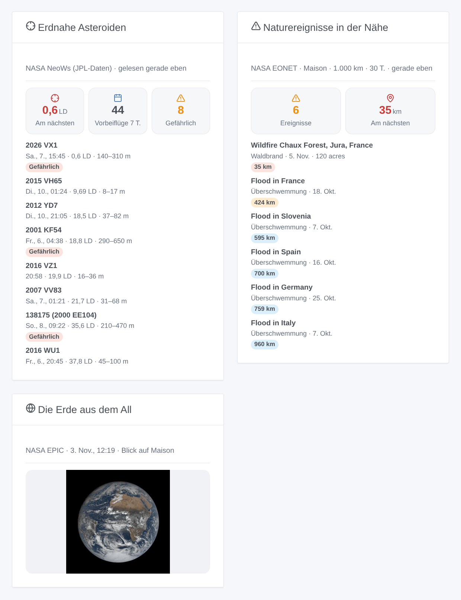

# Gladys NASA

[English](README.md) · [Français](README.fr.md) · **Deutsch** · [Español](README.es.md)

[](LICENSE)
[](https://github.com/William-De71/gladys-nasa/releases)
[](https://github.com/William-De71/gladys-nasa/actions/workflows/release.yml)
[](https://gladysassistant.com)



Externe Integration für [Gladys Assistant](https://gladysassistant.com) mit drei offenen NASA-Diensten: die erdnahen Asteroiden, die in den nächsten 7 Tagen vorbeifliegen ([NeoWs](https://api.nasa.gov/), JPL-Daten), das neueste Bild der ganzen Erde, aufgenommen von [EPIC](https://epic.gsfc.nasa.gov/) an Bord von DSCOVR, und die von [EONET](https://eonet.gsfc.nasa.gov/) erfassten Naturereignisse in der Nähe deiner Zuhause (Waldbrände, Stürme, Überschwemmungen, Vulkane…). Deine Szenen erfahren, wenn ein Asteroid nah vorbeifliegt und wenn in der Nähe ein Brand oder eine Überschwemmung auftritt.

Benutzerdokumentation: [English](docs/en.md) · [Français](docs/fr.md) · [Deutsch](docs/de.md) · [Español](docs/es.md).

Daten: NASA (NeoWs vom Center for Near Earth Object Studies des JPL, EPIC, EONET und seine Quellen). **Nicht mit der NASA verbunden**, ohne NASA-Logo. Gebaut und getestet mit den echten Antworten der drei Dienste vom 5. November 2026; noch nie an einem echten Gladys gelaufen.

## Funktionen

- **Gerät „Erdnahe Asteroiden“**: der nächste Vorbeiflug der kommenden 7 Tage in Kilometern und Mondabständen, sein Name, die Zahl der Vorbeiflüge und der potenziell gefährlichen Asteroiden.
- **Ein Gerät „Naturereignisse“ pro Zuhause mit Standort**: die EONET-Ereignisse im Radius und Zeitraum der Konfiguration, der Abstand des nächsten und sein Titel.
- **3 Szenen-Auslöser** (naher Vorbeiflug unter einer Schwelle, potenziell gefährlicher Asteroid, neues Naturereignis nahe einem Zuhause), **3 Szenen-Aktionen** (die Asteroiden der Woche, die Ereignisse nahe einem Zuhause, das neueste Bild der Erde, jeweils mit einem fertigen Satz) und **3 Widgets** (Asteroiden, die Erde aus dem All mit Blick auf dein Zuhause, Naturereignisse in der Nähe).
- **Sparsam mit kostenlosen Diensten**: NeoWs 4-mal am Tag (der geteilte `DEMO_KEY` reicht, ein kostenloser eigener Schlüssel ist besser), EPIC alle 3 Stunden, EONET jede Stunde mit einem Quadrat um jedes Zuhause, längeres Warten nach jedem Fehler, ein kleiner Cache in `/data`.
- Überall vier Sprachen: Englisch, Französisch, Deutsch, Spanisch.

Das „Bild des Tages“ der NASA (APOD) ist **nicht** enthalten: Seit dem Umzug auf science.nasa.gov liefert seine API für jedes Datum das NASA-Logo und den Titel „NASA Science“ (geprüft am 5. November 2026).

## Funktionsweise





Von der Installation bis zur Szene:



### Transport

`transports: ["cloud"]`: Alles kommt von den drei NASA-Diensten. Was dein Netzwerk verlässt: die Anfragen mit einem User-Agent, der die Integration nennt; dein NASA-Schlüssel, falls angegeben (nur an api.nasa.gov); und für EONET ein Quadrat mit dem gewählten Radius um jedes Zuhause mit Standort (nie seine genaue Position oder sein Name). `/data` speichert die letzten Antworten, die Ereignisse um jedes Zuhause und was die Auslöser schon kennen.

## Geräte und Funktionen

| Gerät                     | Funktion                                                 | Kategorie / Typ               | Einheit / Bereich  |
| ------------------------- | -------------------------------------------------------- | ----------------------------- | ------------------ |
| Erdnahe Asteroiden (NASA) | Nächster Vorbeiflug (km)                                 | `distance-sensor` / `decimal` | km                 |
|                           | Nächster Vorbeiflug (Mondabstände)                       | `unknown` / `unknown`         | 0–600              |
|                           | Vorbeiflüge in 7 Tagen, potenziell gefährlich in 7 Tagen | `counter-sensor` / `integer`  | 0–10.000           |
|                           | Nächster Asteroid                                        | `text` / `text`               | „2015 VH65“        |
| Naturereignisse – Zuhause | Naturereignisse in der Nähe                              | `counter-sensor` / `integer`  | 0–1.000            |
|                           | Nächstes Ereignis (km)                                   | `distance-sensor` / `decimal` | km                 |
|                           | Nächstes Ereignis                                        | `text` / `text`               | „Flood in France…“ |

Gladys hat keine Einheit für den Mondabstand (384.400 km): Diese Funktion hat keine Einheit und nennt sie im Namen. Ohne Ereignis im Radius zeigt der Zähler 0 und der Abstand behält seinen letzten Wert. Nur Änderungen werden veröffentlicht, und beim Erstellen eines Geräts alles erneut.

## Szenen-Auslöser, Aktionen und Widgets



| Art      | Schlüssel                 | Verwendung                                                                                     |
| -------- | ------------------------- | ---------------------------------------------------------------------------------------------- |
| Auslöser | `asteroid_close_approach` | ein Vorbeiflug der nächsten 7 Tage unter der Schwelle (Mondabstände), einmal pro Vorbeiflug    |
| Auslöser | `hazardous_asteroid`      | ein potenziell gefährlicher Asteroid kommt in die nächsten 7 Tage, einmal pro Vorbeiflug       |
| Auslöser | `natural_event_nearby`    | ein neues EONET-Ereignis im Radius eines Zuhauses; Filter nach Zuhause und Kategorien          |
| Aktion   | `get_asteroids`           | Vorbeiflüge, gefährliche, der nächste (Name, Datum, km, LD, Größe, Geschwindigkeit), Satz      |
| Aktion   | `get_natural_events`      | ein Zuhause: Anzahl, nächstes Ereignis (Titel, Kategorie, km, Datum), Satz                     |
| Aktion   | `get_earth_image`         | der Link des neuesten EPIC-Bilds mit Blick auf ein Zuhause, Datum und Mitte, Satz              |
| Widget   | `asteroids`               | nächster Vorbeiflug, Zähler, die 8 nächsten oder kommenden, Details und JPL-Seite              |
| Widget   | `earth`                   | das neueste EPIC-Bild, dessen Mitte der Länge eines Zuhauses am nächsten ist                   |
| Widget   | `natural_events`          | Anzahl, nächster Abstand, die Ereignisse eines Zuhauses mit Kategorie, Ausmaß, Abstand, Quelle |

Jeder Auslöser liefert `{{triggerEvent.data.message}}`, einen Satz in der Sprache der Konfiguration. Ereignisse kommen einmal, nie beim Start, nie nach einer Änderung von Radius oder Zeitraum, nie aus einer Szenen-Aktion. Beispiele:

- Wenn **NASA: naher Vorbeiflug eines Asteroiden** (Schwelle 1 Mondabstand) → `{{triggerEvent.data.message}}` als Benachrichtigung senden.
- Wenn **NASA: Naturereignis in der Nähe** am Zuhause, Kategorien Waldbrände und Schwere Stürme → „{{triggerEvent.data.category_label}} in {{triggerEvent.data.distance_km}} km: {{triggerEvent.data.title}}“ senden.
- Jeden Morgen um 8:00 → Aktion **neuestes Bild der Erde lesen** → `{{…image_url}}` in den Familienchat senden.

## Voraussetzungen

- Gladys Assistant **5.3.0** oder neuer (Widgets und Szenen von Integrationen, Katalog-Stichwörter von Gladys 5.3): Ältere Instanzen können die Integration nicht installieren.
- Internet: Die Integration spricht nur mit `api.nasa.gov`, `epic.gsfc.nasa.gov` und `eonet.gsfc.nasa.gov`.
- Für die Naturereignisse und die Erde mit Blick auf dein Zuhause: ein Zuhause mit Standort in Gladys (die Integration deklariert `location: true`, um ihn zu lesen).
- Optional: ein kostenloser NASA-API-Schlüssel ([api.nasa.gov](https://api.nasa.gov/), eine E-Mail-Adresse genügt).

### Abdeckung von EONET

EONET sammelt Ereignisse anderer Dienste (GDACS für Überschwemmungen, IRWIN für die Waldbrände der USA, JTWC für tropische Wirbelstürme, das Smithsonian für Vulkane…). Für die Waldbrände der USA ist es sehr vollständig, anderswo lückenhaft: Ein ruhiges Widget in Europa ist normal. Es ist kein offizieller Warndienst: Behalte die Warnungen deines Landes.

## Installation

- **Aus dem Store**: Integrationen → NASA → Installieren.
- **Über die URL des Repositorys**: Integrationen → externe Integration → `https://github.com/William-De71/gladys-nasa`.
- **Entwicklermodus**: `npm start` mit den von Gladys gelieferten Variablen starten (siehe Entwicklung).

## Konfiguration

| Feld oder Schaltfläche        | Standard          | Bedeutung                                                                               |
| ----------------------------- | ----------------- | --------------------------------------------------------------------------------------- |
| NASA-API-Schlüssel (optional) | leer (`DEMO_KEY`) | Ein kostenloser Schlüssel von api.nasa.gov: 1.000 Anfragen pro Stunde statt 10 pro IP   |
| Sprache der Texte             | automatisch       | Gerätenamen, Szenen-Sätze und Fehler                                                    |
| Radius um jedes Zuhause       | 500 km            | 100 bis 2.000 km: wie weit ein Naturereignis zählt                                      |
| Ereignisse der letzten        | 14 Tage           | 7, 14 oder 30 Tage                                                                      |
| Naher Vorbeiflug unter        | 5 Mondabstände    | 1 bis 20: für den Auslöser „naher Vorbeiflug“ und die Farben des Widgets                |
| Verbindung testen / Diagnose  | —                 | Liest die drei Dienste; der Zustand in den Protokollen (ohne Schlüssel und Koordinaten) |

## Verwendung

1. Installiere die Integration und erlaube die Koordinaten der Zuhause.
2. Füge optional einen NASA-Schlüssel ein und drücke **Verbindung testen**.
3. **Entdecken**, dann das Gerät „Erdnahe Asteroiden“ und die Geräte „Naturereignisse“ der gewünschten Zuhause hinzufügen.
4. Füge die Widgets einem Dashboard hinzu und baue Szenen mit den Funktionen, Auslösern und Aktionen.

## Entwicklung

```bash
npm install
npm test                       # node --test, eine falsche NASA auf 127.0.0.1 (echte Antworten), nie das Netz
npm run lint                   # ESLint
npm run format:check           # Prettier
npx github:GladysAssistant/integration-store . --skip-image-check
scripts/build-cover.sh         # cover.jpg aus docs/assets/cover.svg
docs/illustrations/render.sh   # docs/assets/widgets.<sprache>.png
```

Lokal liest das SDK `GLADYS_HOST_API_URL`, `GLADYS_INTEGRATION_TOKEN` und `GLADYS_INTEGRATION_SELECTOR` (im Entwicklermodus von Gladys geliefert), die Integration liest `TZ`. `DEBUG=gladys-integration-sdk` zeigt die Protokolle des SDK.

Die Tests decken den HTTP-Client ab (User-Agent, der 7-Tage-Bereich, ein abgelehnter Schlüssel, ein aufgebrauchtes Kontingent, der Schlüssel nie in einer Meldung), die Leser der drei Dienste, die Abstände zu Punkten und Überschwemmungs-Polygonen, jeden Detektor (kein Ereignis beim Start oder nach einer Radiusänderung), die Ausgaben und Daten der Auslöser, die Geräte, die Widgets (`validateWidgetContent`, `validateWidgetImage`), das Manifest, die vier Sprachen, das Release-Skript und die ganze Integration gegen das falsche Gladys des SDK und einen falschen NASA-HTTP-Server. `test/structure.test.js` friert jeden Schlüssel ein, den Benutzer speichern.

## Release-Prozess


Jeder Merge auf `main` startet die CI und berechnet dann die Version aus den [Conventional Commits](https://www.conventionalcommits.org/) seit dem letzten Tag: `feat` → Minor, `fix` / `perf` → Patch, `!` oder `BREAKING CHANGE` → Major (ein Minor unter 1.0.0); `docs`, `chore`, `ci`, `test`, `style`, `refactor`, `build` allein veröffentlichen nichts. Der Changelog-Abschnitt wird erzeugt, das Tag gepusht, das Multi-Architektur-Image gebaut, dann erhält `main` den Release-Commit, das GitHub Release wird erstellt und ein letzter Job prüft das öffentliche Image, den Store-Validator und das Topic.

- Der Titel des Pull Requests wird zum Squash-Commit und dann zur Changelog-Zeile: auf Englisch, für den Benutzer (`pr-title.yml` prüft ihn). `CHANGELOG.md` nie von Hand bearbeiten.
- 1.0.0 ist eine Entscheidung: Actions → Release → Run workflow mit `release-as: 1.0.0`. `dry-run` zeigt Version und Notizen, ohne zu veröffentlichen.
- **Geschützter Branch**: Das Release pusht seinen Commit mit `GITHUB_TOKEN` auf `main`. Das Ruleset `protect-main` (kein Löschen, kein Force-Push) lässt ihn durch; eine strengere Regel (Pull Request Pflicht, Status-Checks) bräuchte GitHub Actions in der Bypass-Liste oder eine GitHub App.
- Nach dem ersten Release das `ghcr.io`-Paket öffentlich machen (Package settings → Change visibility), sonst kann Gladys es nicht laden.

## Fehlerbehebung

Siehe [docs/de.md](docs/de.md#fehlerbehebung). Melde Probleme mit den Versionen von Gladys und der Integration, der Meldung von **Verbindung testen** und dem Ergebnis der **Diagnose** (in den Protokollen der Integration).

## Mitwirken

Issues und Pull Requests sind willkommen. Führe vor einem Pull Request `npm run format:check && npm run lint && npm test` aus und lass alle externen IDs und gespeicherten Schlüssel unverändert (siehe [CLAUDE.md](CLAUDE.md)).

## Sicherheit

Siehe [SECURITY.md](SECURITY.md): Melde Schwachstellen vertraulich. Der NASA-Schlüssel ist ein Geheimnis der Konfiguration: Er erscheint nie in den Protokollen, Fehlern, der Diagnose oder `/data`; auch die Koordinaten der Zuhause erscheinen nie in den Protokollen.

## Kommende Screenshots

Die Bilder oben sind Illustrationen, keine Screenshots. Echte Screenshots kommen nach `docs/assets/screenshots/` (PNG, 1280 × 800): `configuration.png`, `discovery.png` (die Geräte Asteroiden und Naturereignisse), `device.png` (das Asteroiden-Gerät mit seinen Funktionen), `scene-event.png` (eine Szene mit „Naturereignis in der Nähe“).

## Lizenz

[Apache-Lizenz 2.0](LICENSE) — siehe auch [NOTICE](NOTICE). Daten: NASA und die Quellen von EONET; diese Integration ist nicht mit der NASA verbunden. Danke an die Dokumentation und das SDK von Gladys und an die NASA für ihre offenen Daten.
