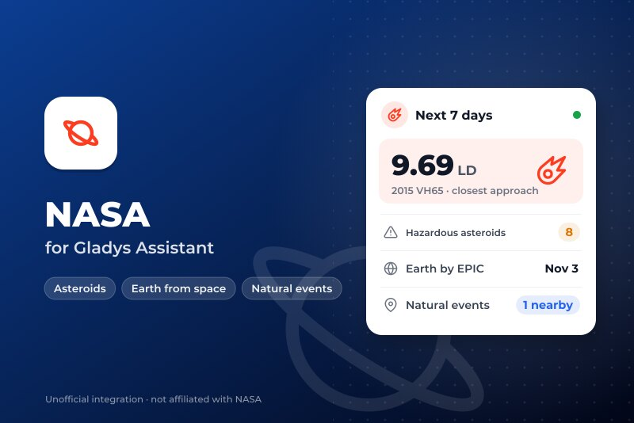
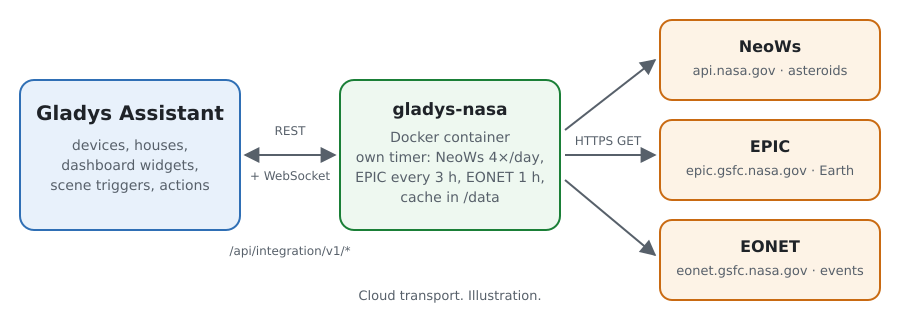
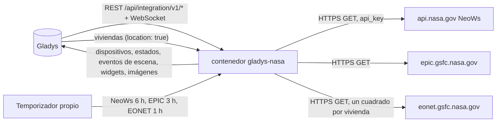
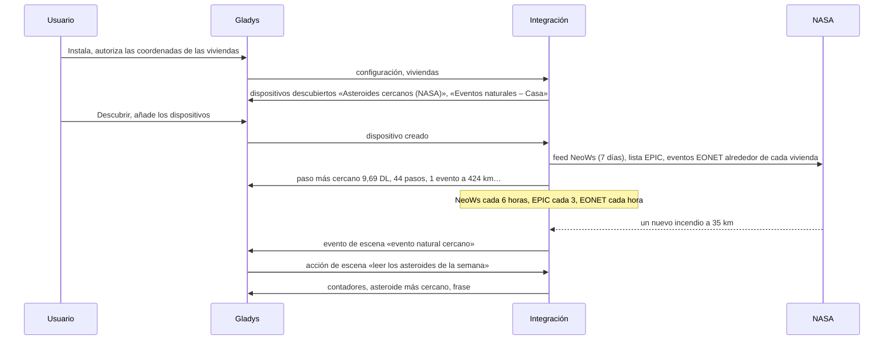
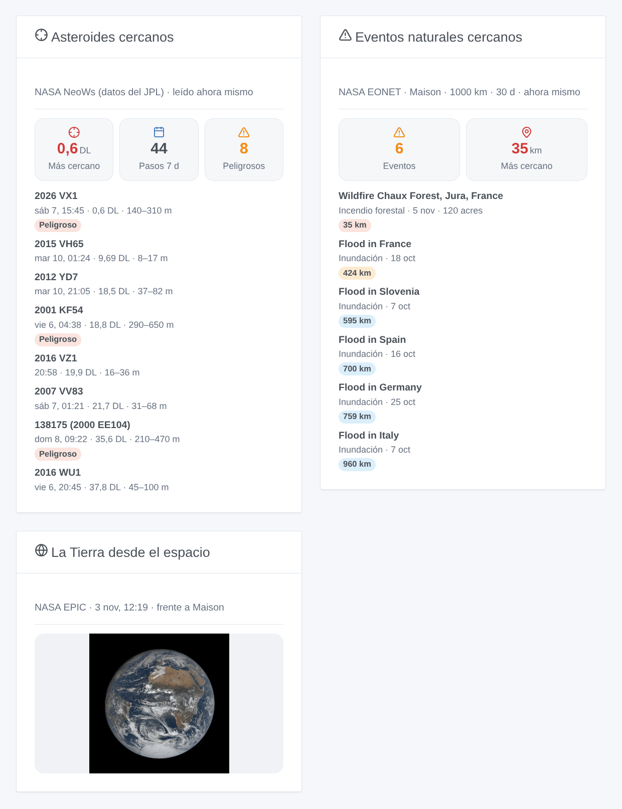

# Gladys NASA

[English](README.md) · [Français](README.fr.md) · [Deutsch](README.de.md) · **Español**

[](LICENSE)
[](https://github.com/William-De71/gladys-nasa/releases)
[](https://github.com/William-De71/gladys-nasa/actions/workflows/release.yml)
[](https://gladysassistant.com)



Integración externa de [Gladys Assistant](https://gladysassistant.com) para tres servicios abiertos de la NASA: los asteroides cercanos a la Tierra que pasan en los próximos 7 días ([NeoWs](https://api.nasa.gov/), datos del JPL), la última imagen de la Tierra entera tomada por [EPIC](https://epic.gsfc.nasa.gov/) a bordo de DSCOVR, y los eventos naturales que sigue [EONET](https://eonet.gsfc.nasa.gov/) cerca de sus viviendas (incendios forestales, tormentas, inundaciones, volcanes…). Sus escenas saben cuándo un asteroide pasa cerca y cuándo aparece un incendio o una inundación cerca de casa.

Documentación de usuario: [English](docs/en.md) · [Français](docs/fr.md) · [Deutsch](docs/de.md) · [Español](docs/es.md).

Datos: NASA (NeoWs del Center for Near Earth Object Studies del JPL, EPIC, EONET y sus fuentes). **No afiliada a la NASA**, y sin ningún logotipo de la NASA. Construida y probada con las respuestas reales de los tres servicios del 5 de noviembre de 2026; nunca ejecutada todavía en un Gladys real.

## Funciones

- **Dispositivo Asteroides cercanos**: el paso más cercano de los próximos 7 días en kilómetros y en distancias lunares, su nombre, el número de pasos y de asteroides potencialmente peligrosos.
- **Un dispositivo Eventos naturales por vivienda ubicada**: los eventos EONET dentro del radio y del periodo de la configuración, la distancia del más cercano y su título.
- **3 desencadenadores de escena** (paso cercano bajo un umbral, asteroide potencialmente peligroso, nuevo evento natural cerca de una vivienda), **3 acciones de escena** (los asteroides de la semana, los eventos cerca de una vivienda, la última imagen de la Tierra, cada una con una frase lista para enviar) y **3 widgets** (asteroides, la Tierra desde el espacio frente a su vivienda, los eventos naturales cercanos).
- **Sobria con servicios gratuitos**: NeoWs 4 veces al día (la clave compartida `DEMO_KEY` basta, una clave personal gratuita es mejor), EPIC cada 3 horas, EONET cada hora con un cuadrado alrededor de cada vivienda, una espera más larga tras cada fallo, una pequeña caché en `/data`.
- Cuatro idiomas en todas partes: inglés, francés, alemán, español.

La «imagen del día» de la NASA (APOD) **no** está incluida: desde su paso a science.nasa.gov, su API responde el logotipo de la NASA y el título «NASA Science» para todas las fechas (comprobado el 5 de noviembre de 2026).

## Cómo funciona





De la instalación a una escena:



### Transporte

`transports: ["cloud"]`: todo viene de los tres servicios de la NASA. Lo que sale de su red: las peticiones, con un User-Agent que nombra la integración; su clave de la NASA si la indicó (solo hacia api.nasa.gov); y, para EONET, un cuadrado del radio elegido alrededor de cada vivienda ubicada (nunca su posición exacta, ni su nombre). `/data` guarda las últimas respuestas, los eventos alrededor de cada vivienda y lo que los desencadenadores ya conocen.

## Dispositivos y funciones

| Dispositivo                  | Función                                              | Categoría / tipo              | Unidad / rango     |
| ---------------------------- | ---------------------------------------------------- | ----------------------------- | ------------------ |
| Asteroides cercanos (NASA)   | Paso más cercano (km)                                | `distance-sensor` / `decimal` | km                 |
|                              | Paso más cercano (distancias lunares)                | `unknown` / `unknown`         | 0–600              |
|                              | Pasos en 7 días, potencialmente peligrosos en 7 días | `counter-sensor` / `integer`  | 0–10 000           |
|                              | Asteroide más cercano                                | `text` / `text`               | «2015 VH65»        |
| Eventos naturales – vivienda | Eventos naturales cercanos                           | `counter-sensor` / `integer`  | 0–1000             |
|                              | Evento más cercano (km)                              | `distance-sensor` / `decimal` | km                 |
|                              | Evento más cercano                                   | `text` / `text`               | «Flood in France…» |

Gladys no tiene unidad para la distancia lunar (384 400 km): esa función no tiene unidad y lo dice en su nombre. Sin evento en el radio, el contador vale 0 y la distancia conserva su último valor. Solo se publican los cambios, y todo de nuevo al crear un dispositivo.

## Disparadores, acciones y widgets



| Tipo           | Clave                     | Uso                                                                                            |
| -------------- | ------------------------- | ---------------------------------------------------------------------------------------------- |
| Desencadenador | `asteroid_close_approach` | un paso de los próximos 7 días bajo el umbral (distancias lunares), una vez por paso           |
| Desencadenador | `hazardous_asteroid`      | un asteroide potencialmente peligroso entra en los próximos 7 días, una vez por paso           |
| Desencadenador | `natural_event_nearby`    | un nuevo evento EONET en el radio de una vivienda; filtro por vivienda y categorías            |
| Acción         | `get_asteroids`           | pasos, peligrosos, el más cercano (nombre, fecha, km, DL, tamaño, velocidad), frase            |
| Acción         | `get_natural_events`      | una vivienda: número, evento más cercano (título, categoría, km, fecha), frase                 |
| Acción         | `get_earth_image`         | el enlace de la última imagen EPIC frente a una vivienda, su fecha y centro, frase             |
| Widget         | `asteroids`               | paso más cercano, contadores, los 8 más cercanos o próximos, detalles y ficha del JPL          |
| Widget         | `earth`                   | la última imagen EPIC cuyo centro es el más cercano a la longitud de una vivienda              |
| Widget         | `natural_events`          | número, distancia del más cercano, los eventos de una vivienda con categoría, magnitud, fuente |

Cada desencadenador da `{{triggerEvent.data.message}}`, una frase en el idioma de la configuración. Los eventos se disparan una sola vez, nunca al arrancar, nunca tras un cambio de radio o de periodo, nunca desde una acción de escena. Ejemplos:

- Cuando **NASA: paso cercano de un asteroide** (umbral 1 distancia lunar) → enviar `{{triggerEvent.data.message}}` como notificación.
- Cuando **NASA: evento natural cercano** en la vivienda, categorías Incendios forestales y Tormentas severas → enviar «{{triggerEvent.data.category_label}} a {{triggerEvent.data.distance_km}} km: {{triggerEvent.data.title}}».
- Cada mañana a las 8:00 → acción **leer la última imagen de la Tierra** → enviar `{{…image_url}}` al chat familiar.

## Requisitos

- Gladys Assistant **5.3.0** o posterior (widgets y escenas de las integraciones, palabras clave del catálogo de Gladys 5.3): las instancias más antiguas no pueden instalar la integración.
- Internet: la integración solo habla con `api.nasa.gov`, `epic.gsfc.nasa.gov` y `eonet.gsfc.nasa.gov`.
- Para los eventos naturales y la Tierra frente a su vivienda: una vivienda ubicada en Gladys (la integración declara `location: true` para leerla).
- Opcional: una clave de API gratuita de la NASA ([api.nasa.gov](https://api.nasa.gov/), basta una dirección de correo).

### Cobertura de EONET

EONET reúne eventos de otros servicios (GDACS para las inundaciones, IRWIN para los incendios de Estados Unidos, JTWC para los ciclones tropicales, el Smithsonian para los volcanes…). Es muy completo para los incendios de Estados Unidos, parcial en otros lugares: un widget tranquilo en Europa es normal. No es un servicio oficial de alertas: conserve las alertas de su país.

## Instalación

- **Desde el store**: Integraciones → NASA → Instalar.
- **Desde la URL del repositorio**: Integraciones → integración externa → `https://github.com/William-De71/gladys-nasa`.
- **Modo desarrollador**: ejecute `npm start` con las variables que da Gladys (ver Desarrollo).

## Configuración

| Campo o botón                      | Por defecto          | Significado                                                                        |
| ---------------------------------- | -------------------- | ---------------------------------------------------------------------------------- |
| Clave de API de la NASA (opcional) | vacío (`DEMO_KEY`)   | Una clave gratuita de api.nasa.gov: 1000 peticiones por hora en lugar de 10 por IP |
| Idioma de los textos               | automático           | Nombres de los dispositivos, frases de las escenas y errores                       |
| Radio alrededor de cada vivienda   | 500 km               | 100 a 2000 km: hasta dónde cuenta un evento natural                                |
| Eventos de los últimos             | 14 días              | 7, 14 o 30 días                                                                    |
| Paso cercano a menos de            | 5 distancias lunares | 1 a 20: para el desencadenador de paso cercano y los colores del widget            |
| Probar la conexión / Diagnóstico   | —                    | Lee los tres servicios; el estado en los registros (sin clave ni coordenadas)      |

## Uso

1. Instale la integración y autorice las coordenadas de las viviendas.
2. Pegue si quiere una clave de la NASA y pulse **Probar la conexión**.
3. **Descubrir**, luego añada el dispositivo Asteroides cercanos y los dispositivos Eventos naturales de las viviendas que quiera.
4. Añada los widgets a un panel y cree escenas con las funciones, los desencadenadores y las acciones.

## Desarrollo

```bash
npm install
npm test                       # node --test, una NASA falsa en 127.0.0.1 (respuestas reales), nunca la red
npm run lint                   # ESLint
npm run format:check           # Prettier
npx github:GladysAssistant/integration-store . --skip-image-check
scripts/build-cover.sh         # cover.jpg desde docs/assets/cover.svg
docs/illustrations/render.sh   # docs/assets/widgets.<idioma>.png
```

En local, el SDK lee `GLADYS_HOST_API_URL`, `GLADYS_INTEGRATION_TOKEN` y `GLADYS_INTEGRATION_SELECTOR` (que Gladys da en modo desarrollador), y la integración lee `TZ`. `DEBUG=gladys-integration-sdk` muestra los registros del SDK.

Las pruebas cubren el cliente HTTP (User-Agent, el rango de 7 días, una clave rechazada, una cuota agotada, la clave nunca en un mensaje), los lectores de los tres servicios, las distancias a puntos y polígonos de inundación, cada detector (ningún evento al arrancar ni tras un cambio de radio), las salidas y los datos de los desencadenadores, los dispositivos, los widgets (`validateWidgetContent`, `validateWidgetImage`), el manifiesto, los cuatro idiomas, el script de release, y la integración completa frente al Gladys falso del SDK y un servidor HTTP falso de la NASA. `test/structure.test.js` congela cada clave que guardan los usuarios.

## Proceso de release


Cada fusión en `main` ejecuta la CI y calcula la versión a partir de los [Conventional Commits](https://www.conventionalcommits.org/) desde la última etiqueta: `feat` → menor, `fix` / `perf` → parche, `!` o `BREAKING CHANGE` → mayor (una menor por debajo de 1.0.0); `docs`, `chore`, `ci`, `test`, `style`, `refactor`, `build` solos no publican nada. Se genera la sección del changelog, se sube la etiqueta, se construye la imagen multiarquitectura, luego `main` recibe el commit de release, se crea la GitHub Release y un último job comprueba la imagen pública, el validador de la tienda y el topic.

- El título de la pull request se convierte en el commit squash y luego en la línea del changelog: escríbalo en inglés, para el usuario (`pr-title.yml` lo comprueba). Nunca edite `CHANGELOG.md` a mano.
- La 1.0.0 es una decisión: Actions → Release → Run workflow con `release-as: 1.0.0`. `dry-run` muestra la versión y las notas sin publicar nada.
- **Rama protegida**: la release sube su commit a `main` con `GITHUB_TOKEN`. El ruleset `protect-main` (sin borrado, sin force-push) lo deja pasar; una regla más estricta (pull request obligatoria, status checks) necesitaría GitHub Actions en su lista de exclusión, o una GitHub App.
- Tras la primera release, haga público el paquete `ghcr.io` (Package settings → Change visibility), si no Gladys no puede descargarlo.

## Solución de problemas

Vea [docs/es.md](docs/es.md#solución-de-problemas). Informe de los problemas con las versiones de Gladys y de la integración, el mensaje de **Probar la conexión** y el resultado del **Diagnóstico** (en los registros de la integración).

## Contribuir

Las issues y pull requests son bienvenidas. Ejecute `npm run format:check && npm run lint && npm test` antes de abrir una pull request, y mantenga sin cambios todos los identificadores externos y las claves guardadas (vea [CLAUDE.md](CLAUDE.md)).

## Seguridad

Vea [SECURITY.md](SECURITY.md): informe de las vulnerabilidades en privado. La clave de la NASA es un secreto de la configuración: nunca aparece en los registros, los errores, el diagnóstico ni `/data`; las coordenadas de las viviendas tampoco aparecen en los registros.

## Capturas por venir

Las imágenes de arriba son ilustraciones, no capturas. Las capturas reales irán en `docs/assets/screenshots/` (PNG, 1280 × 800): `configuration.png`, `discovery.png` (los dispositivos asteroides y eventos naturales), `device.png` (el dispositivo asteroides y sus funciones), `scene-event.png` (una escena con «evento natural cercano»).

## Licencia

[Licencia Apache 2.0](LICENSE) — vea también [NOTICE](NOTICE). Datos: NASA y las fuentes de EONET; esta integración no está afiliada a la NASA. Gracias a la documentación y al SDK de Gladys, y a la NASA por sus datos abiertos.
