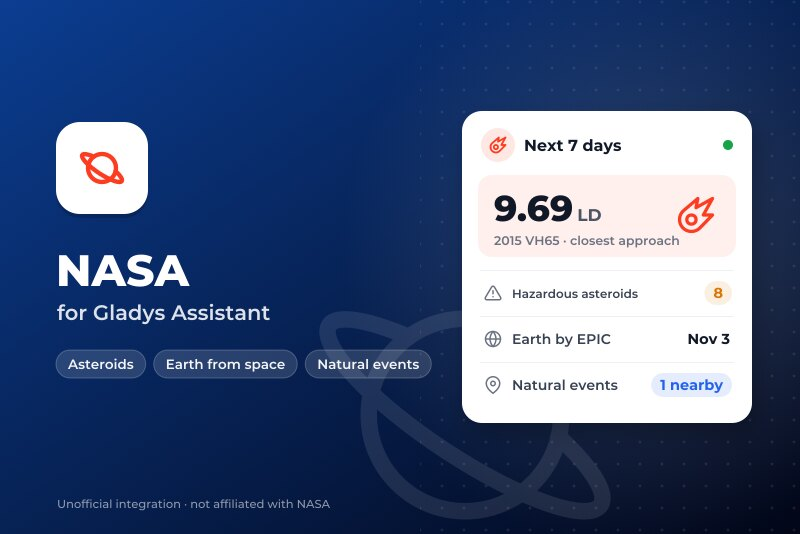
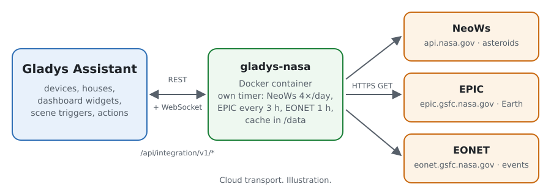
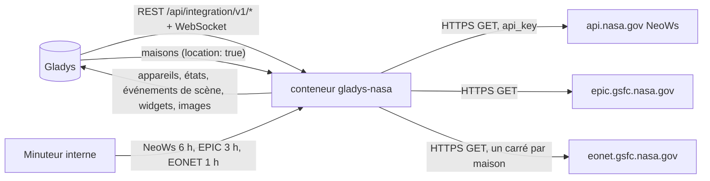
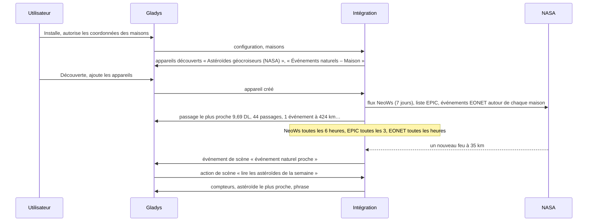
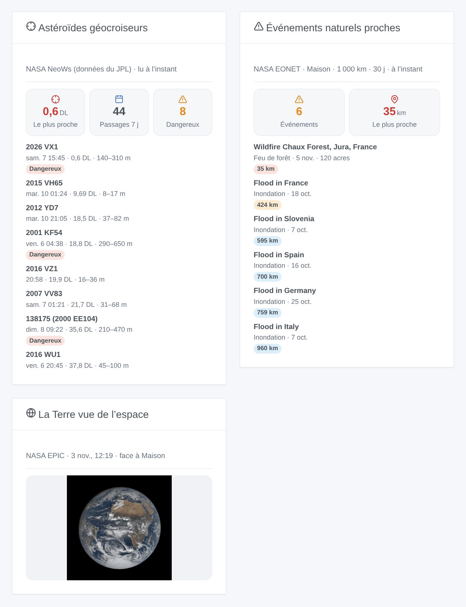

# Gladys NASA

[English](README.md) · **Français** · [Deutsch](README.de.md) · [Español](README.es.md)

[](LICENSE)
[](https://github.com/William-De71/gladys-nasa/releases)
[](https://github.com/William-De71/gladys-nasa/actions/workflows/release.yml)
[](https://gladysassistant.com)



Intégration externe de [Gladys Assistant](https://gladysassistant.com) pour trois services ouverts de la NASA : les astéroïdes géocroiseurs qui passent ces 7 prochains jours ([NeoWs](https://api.nasa.gov/), données du JPL), la dernière image de la Terre entière prise par [EPIC](https://epic.gsfc.nasa.gov/) à bord de DSCOVR, et les événements naturels suivis par [EONET](https://eonet.gsfc.nasa.gov/) autour de vos maisons (feux de forêt, tempêtes, inondations, volcans…). Vos scènes savent quand un astéroïde passe près de la Terre, et quand un feu ou une inondation apparaît près de chez vous.

Documentation utilisateur : [English](docs/en.md) · [Français](docs/fr.md) · [Deutsch](docs/de.md) · [Español](docs/es.md).

Données : NASA (NeoWs du Center for Near Earth Object Studies du JPL, EPIC, EONET et ses sources). **Non affiliée à la NASA**, et sans aucun logo de la NASA. Construite et testée sur les vraies réponses des trois services du 5 novembre 2026 ; jamais encore lancée sur un vrai Gladys.

## Fonctionnalités

- **Appareil Astéroïdes géocroiseurs** : le passage le plus proche des 7 prochains jours en kilomètres et en distances lunaires, son nom, le nombre de passages et d’astéroïdes potentiellement dangereux.
- **Un appareil Événements naturels par maison localisée** : les événements EONET dans le rayon et la période de la configuration, la distance du plus proche et son titre.
- **3 déclencheurs de scène** (passage proche sous un seuil, astéroïde potentiellement dangereux, nouvel événement naturel près d’une maison), **3 actions de scène** (les astéroïdes de la semaine, les événements près d’une maison, la dernière image de la Terre, chacune avec une phrase prête à envoyer) et **3 widgets** (astéroïdes, la Terre vue de l’espace face à votre maison, les événements naturels proches).
- **Sobre avec des services gratuits** : NeoWs 4 fois par jour (la clé partagée `DEMO_KEY` suffit, une clé personnelle gratuite est préférable), EPIC toutes les 3 heures, EONET toutes les heures avec un carré autour de chaque maison, une attente plus longue après chaque échec, un petit cache dans `/data`.
- Quatre langues partout : anglais, français, allemand, espagnol.

L’« image du jour » de la NASA (APOD) n’est **pas** incluse : depuis son passage sur science.nasa.gov, son API répond le logo de la NASA et le titre « NASA Science » pour toutes les dates (vérifié le 5 novembre 2026).

## Fonctionnement





De l’installation à une scène :



### Transport

`transports: ["cloud"]` : tout vient des trois services de la NASA. Ce qui sort de votre réseau : les requêtes, avec un User-Agent qui nomme l’intégration ; votre clé NASA si vous en avez donné une (vers api.nasa.gov seulement) ; et, pour EONET, un carré du rayon choisi autour de chaque maison localisée (jamais sa position exacte, ni son nom). `/data` garde les dernières réponses, les événements autour de chaque maison et ce que les déclencheurs savent déjà.

## Appareils et fonctionnalités

| Appareil                       | Fonctionnalité                                              | Catégorie / type              | Unité / plage        |
| ------------------------------ | ----------------------------------------------------------- | ----------------------------- | -------------------- |
| Astéroïdes géocroiseurs (NASA) | Passage le plus proche (km)                                 | `distance-sensor` / `decimal` | km                   |
|                                | Passage le plus proche (distances lunaires)                 | `unknown` / `unknown`         | 0–600                |
|                                | Passages sur 7 jours, potentiellement dangereux sur 7 jours | `counter-sensor` / `integer`  | 0–10 000             |
|                                | Astéroïde le plus proche                                    | `text` / `text`               | « 2015 VH65 »        |
| Événements naturels – maison   | Événements naturels proches                                 | `counter-sensor` / `integer`  | 0–1 000              |
|                                | Événement le plus proche (km)                               | `distance-sensor` / `decimal` | km                   |
|                                | Événement le plus proche                                    | `text` / `text`               | « Flood in France… » |

Gladys n’a pas d’unité pour la distance lunaire (384 400 km) : cette fonctionnalité n’a pas d’unité et le dit dans son nom. Sans événement dans le rayon, le compteur vaut 0 et la distance garde sa dernière valeur. Seuls les changements sont publiés, et tout est renvoyé à la création d’un appareil.

## Déclencheurs, actions et widgets



| Type        | Clé                       | Usage                                                                                          |
| ----------- | ------------------------- | ---------------------------------------------------------------------------------------------- |
| Déclencheur | `asteroid_close_approach` | un passage des 7 prochains jours sous le seuil (distances lunaires), une fois par passage      |
| Déclencheur | `hazardous_asteroid`      | un astéroïde potentiellement dangereux entre dans les 7 prochains jours, une fois par passage  |
| Déclencheur | `natural_event_nearby`    | un nouvel événement EONET dans le rayon d’une maison ; filtre par maison et catégories         |
| Action      | `get_asteroids`           | passages, dangereux, le plus proche (nom, date, km, DL, taille, vitesse), phrase               |
| Action      | `get_natural_events`      | une maison : nombre, événement le plus proche (titre, catégorie, km, date), phrase             |
| Action      | `get_earth_image`         | le lien de la dernière image EPIC face à une maison, sa date et son centre, phrase             |
| Widget      | `asteroids`               | passage le plus proche, compteurs, les 8 plus proches ou prochains, détails et fiche du JPL    |
| Widget      | `earth`                   | la dernière image EPIC dont le centre est le plus proche de la longitude d’une maison          |
| Widget      | `natural_events`          | nombre, distance du plus proche, les événements d’une maison avec catégorie, ampleur, distance |

Chaque déclencheur donne `{{triggerEvent.data.message}}`, une phrase dans la langue de la configuration. Les événements partent une seule fois, jamais au démarrage, jamais après un changement de rayon ou de période, jamais depuis une action de scène. Exemples :

- Quand **NASA : passage proche d’un astéroïde** (seuil 1 distance lunaire) → envoyer `{{triggerEvent.data.message}}` en notification.
- Quand **NASA : événement naturel proche** à la maison, catégories Feux de forêt et Tempêtes violentes → envoyer « {{triggerEvent.data.category_label}} à {{triggerEvent.data.distance_km}} km : {{triggerEvent.data.title}} ».
- Chaque matin à 8 h → action **lire la dernière image de la Terre** → envoyer `{{…image_url}}` dans le salon familial.

## Prérequis

- Gladys Assistant **5.3.0** ou plus récent (widgets et scènes des intégrations, mots-clés du catalogue de Gladys 5.3) : les instances plus anciennes ne peuvent pas installer l’intégration.
- Internet : l’intégration ne parle qu’à `api.nasa.gov`, `epic.gsfc.nasa.gov` et `eonet.gsfc.nasa.gov`.
- Pour les événements naturels et la Terre face à votre maison : une maison localisée dans Gladys (l’intégration déclare `location: true` pour la lire).
- Facultatif : une clé d’API gratuite de la NASA ([api.nasa.gov](https://api.nasa.gov/), une adresse e-mail suffit).

### Couverture d’EONET

EONET rassemble les événements d’autres services (GDACS pour les inondations, IRWIN pour les feux des États-Unis, JTWC pour les cyclones tropicaux, le Smithsonian pour les volcans…). Il est très complet pour les feux des États-Unis, partiel ailleurs : un widget calme en Europe est normal. Ce n’est pas un service d’alerte officiel : gardez les alertes de votre pays.

## Installation

- **Depuis le store** : Intégrations → NASA → Installer.
- **Depuis l’URL du dépôt** : Intégrations → intégration externe → `https://github.com/William-De71/gladys-nasa`.
- **Mode développeur** : lancez `npm start` avec les variables fournies par Gladys (voir Développement).

## Configuration

| Champ ou bouton                    | Défaut               | Rôle                                                                            |
| ---------------------------------- | -------------------- | ------------------------------------------------------------------------------- |
| Clé d’API de la NASA (facultative) | vide (`DEMO_KEY`)    | Une clé gratuite d’api.nasa.gov : 1 000 requêtes par heure au lieu de 10 par IP |
| Langue des textes                  | automatique          | Noms des appareils, phrases des scènes et erreurs                               |
| Rayon autour de chaque maison      | 500 km               | 100 à 2 000 km : jusqu’où un événement naturel compte                           |
| Événements des derniers            | 14 jours             | 7, 14 ou 30 jours                                                               |
| Passage proche à moins de          | 5 distances lunaires | 1 à 20 : pour le déclencheur de passage proche et les couleurs du widget        |
| Tester la connexion / Diagnostic   | —                    | Lit les trois services ; l’état dans les journaux (ni clé ni coordonnées)       |

## Utilisation

1. Installez l’intégration et autorisez les coordonnées des maisons.
2. Collez éventuellement une clé de la NASA, puis appuyez sur **Tester la connexion**.
3. **Découverte**, puis ajoutez l’appareil Astéroïdes géocroiseurs et les appareils Événements naturels des maisons voulues.
4. Ajoutez les widgets à un tableau de bord, et construisez des scènes avec les fonctionnalités, les déclencheurs et les actions.

## Développement

```bash
npm install
npm test                       # node --test, une fausse NASA sur 127.0.0.1 (vraies réponses), jamais le réseau
npm run lint                   # ESLint
npm run format:check           # Prettier
npx github:GladysAssistant/integration-store . --skip-image-check
scripts/build-cover.sh         # cover.jpg depuis docs/assets/cover.svg
docs/illustrations/render.sh   # docs/assets/widgets.<langue>.png
```

En local, le SDK lit `GLADYS_HOST_API_URL`, `GLADYS_INTEGRATION_TOKEN` et `GLADYS_INTEGRATION_SELECTOR` (fournis par Gladys en mode développeur), et l’intégration lit `TZ`. `DEBUG=gladys-integration-sdk` affiche les journaux du SDK.

Les tests couvrent le client HTTP (User-Agent, la plage de 7 jours, une clé refusée, un quota épuisé, la clé jamais dans un message), les lecteurs des trois services, les distances aux points et aux polygones d’inondation, chaque détecteur (aucun événement au démarrage ni après un changement de rayon), les sorties et les données des déclencheurs, les appareils, les widgets (`validateWidgetContent`, `validateWidgetImage`), le manifeste, les quatre langues, le script de release, et l’intégration entière face au faux Gladys du SDK et à un faux serveur HTTP de la NASA. `test/structure.test.js` fige chaque clé que les utilisateurs stockent.

## Processus de release


Chaque fusion sur `main` lance la CI, puis calcule la version depuis les [Conventional Commits](https://www.conventionalcommits.org/) depuis le dernier tag : `feat` → mineure, `fix` / `perf` → correctif, `!` ou `BREAKING CHANGE` → majeure (une mineure sous 1.0.0) ; `docs`, `chore`, `ci`, `test`, `style`, `refactor`, `build` seuls ne publient rien. La section du changelog est générée, le tag poussé, l’image multi-architecture construite, puis `main` reçoit le commit de release, la GitHub Release est créée et un dernier job vérifie l’image publique, le validateur du store et le topic.

- Le titre de la pull request devient le commit squash, puis la ligne du changelog : écrivez-le en anglais, pour l’utilisateur (`pr-title.yml` le vérifie). N’éditez jamais `CHANGELOG.md` à la main.
- La 1.0.0 est une décision : Actions → Release → Run workflow avec `release-as: 1.0.0`. `dry-run` affiche la version et les notes sans rien publier.
- **Branche protégée** : la release pousse son commit sur `main` avec `GITHUB_TOKEN`. Le ruleset `protect-main` (pas de suppression, pas de force-push) le laisse passer ; une règle plus stricte (pull request obligatoire, status checks) demanderait GitHub Actions en contournement, ou une GitHub App.
- Après la première release, rendez public le package `ghcr.io` (Package settings → Change visibility), sinon Gladys ne peut pas le télécharger.

## Dépannage

Voir [docs/fr.md](docs/fr.md#dépannage). Signalez les problèmes avec les versions de Gladys et de l’intégration, le message de **Tester la connexion** et le résultat du **Diagnostic** (dans les journaux de l’intégration).

## Contribuer

Les issues et pull requests sont les bienvenues. Lancez `npm run format:check && npm run lint && npm test` avant d’ouvrir une pull request, et gardez inchangés tous les identifiants externes et clés stockées (voir [CLAUDE.md](CLAUDE.md)).

## Sécurité

Voir [SECURITY.md](SECURITY.md) : signalez les vulnérabilités en privé. La clé de la NASA est un secret de la configuration : elle n’apparaît jamais dans les journaux, les erreurs, le diagnostic ni `/data` ; les coordonnées des maisons n’apparaissent pas non plus dans les journaux.

## Captures à venir

Les images ci-dessus sont des illustrations, pas des captures. Les vraies captures iront dans `docs/assets/screenshots/` (PNG, 1280 × 800) : `configuration.png`, `discovery.png` (les appareils astéroïdes et événements naturels), `device.png` (l’appareil astéroïdes et ses fonctionnalités), `scene-event.png` (une scène sur « événement naturel proche »).

## Licence

[Licence Apache 2.0](LICENSE) — voir aussi [NOTICE](NOTICE). Données : NASA et les sources d’EONET ; cette intégration n’est pas affiliée à la NASA. Merci à la documentation et au SDK de Gladys, et à la NASA pour ses données ouvertes.
