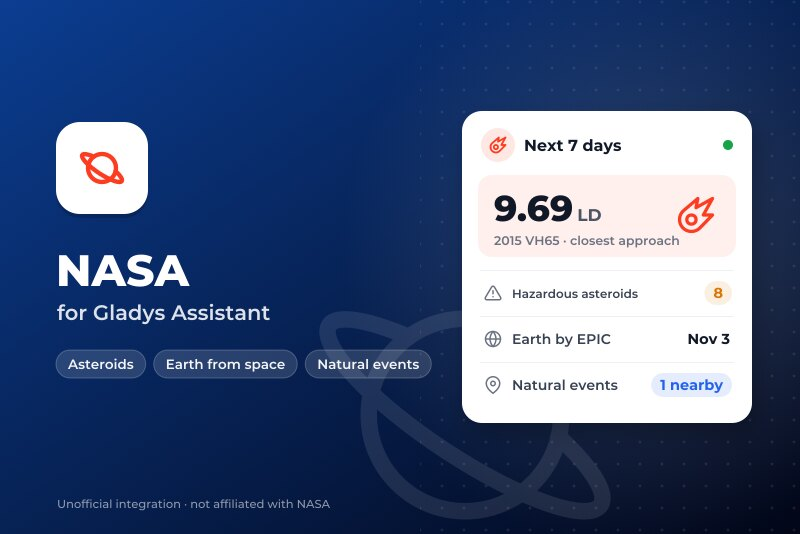
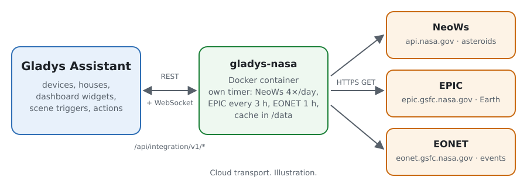
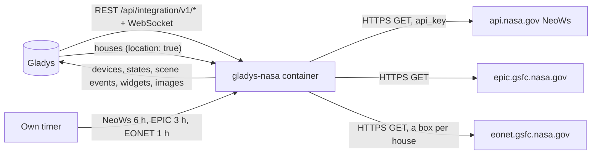
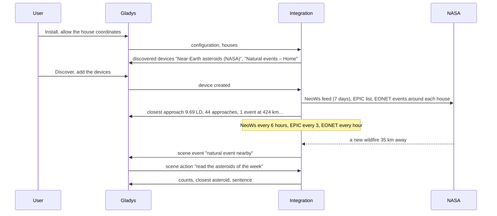
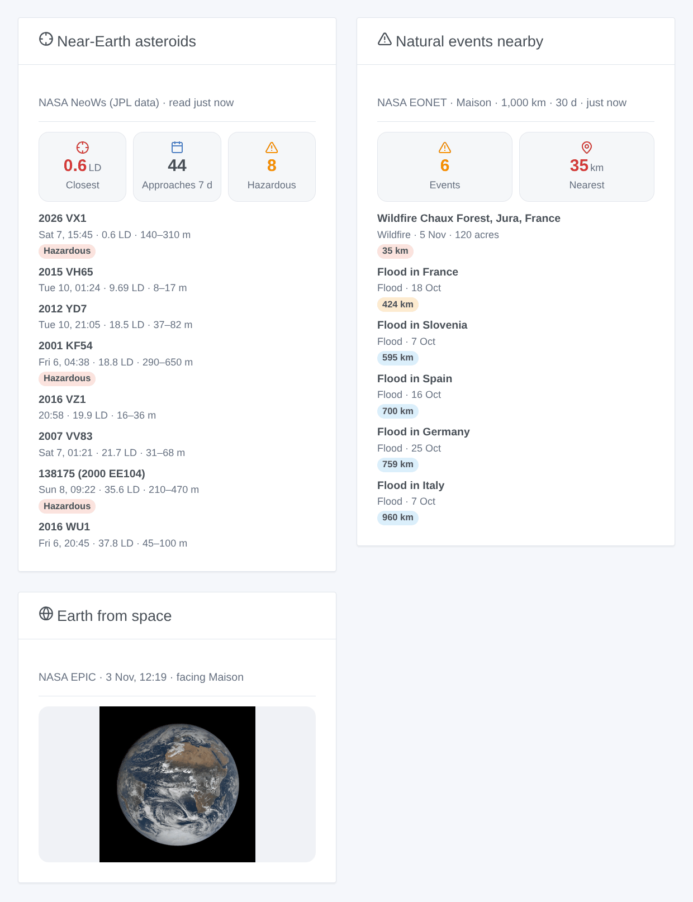

# Gladys NASA

**English** · [Français](README.fr.md) · [Deutsch](README.de.md) · [Español](README.es.md)

[](LICENSE)
[](https://github.com/William-De71/gladys-nasa/releases)
[](https://github.com/William-De71/gladys-nasa/actions/workflows/release.yml)
[](https://gladysassistant.com)



[Gladys Assistant](https://gladysassistant.com) external integration for three open NASA services: the near-Earth asteroids passing in the next 7 days ([NeoWs](https://api.nasa.gov/), JPL data), the latest image of the whole Earth taken by [EPIC](https://epic.gsfc.nasa.gov/) on board DSCOVR, and the natural events tracked by [EONET](https://eonet.gsfc.nasa.gov/) near your houses (wildfires, storms, floods, volcanoes…). Your scenes learn when an asteroid passes close, and when a fire or a flood appears near home.

User documentation: [English](docs/en.md) · [Français](docs/fr.md) · [Deutsch](docs/de.md) · [Español](docs/es.md).

Data: NASA (NeoWs from the JPL Center for Near Earth Object Studies, EPIC, EONET and its sources). **Not affiliated with NASA**, and without any NASA logo. Built and tested on the real answers of the three services of 5 November 2026; never run against a real Gladys yet.

## Features

- **Near-Earth asteroids device**: the closest approach of the next 7 days in kilometres and in lunar distances, its name, the number of approaches and of potentially hazardous asteroids.
- **One Natural events device per located house**: the EONET events within the radius and the period of the configuration, the distance of the nearest one and its title.
- **3 scene triggers** (close approach under a threshold, potentially hazardous asteroid, new natural event near a house), **3 scene actions** (the asteroids of the week, the events near a house, the latest image of the Earth, each with a sentence ready to send) and **3 dashboard widgets** (asteroids, the Earth from space facing your house, the natural events nearby).
- **Sober with free services**: NeoWs 4 times a day (the shared `DEMO_KEY` works, a free personal key is better), EPIC every 3 hours, EONET every hour with a box around each house, a longer wait after each failure, a small cache in `/data`.
- Four languages everywhere: English, French, German, Spanish.

The NASA "picture of the day" (APOD) is **not** included: since its move to science.nasa.gov, its API answers the NASA logo and the title "NASA Science" for every date (checked on 5 November 2026).

## How it works





From the installation to a scene:



### Transport

`transports: ["cloud"]`: everything comes from the three NASA services. What leaves your network: the requests, with a User-Agent naming the integration; your NASA key if you gave one (to api.nasa.gov only); and, for EONET, a box of the radius you chose around each located house (never its exact position, nor its name). `/data` keeps the last answers, the events near each house and what the scene triggers already know.

## Devices and features

| Device                      | Feature                                               | Category / type               | Unit / range       |
| --------------------------- | ----------------------------------------------------- | ----------------------------- | ------------------ |
| Near-Earth asteroids (NASA) | Closest approach (km)                                 | `distance-sensor` / `decimal` | km                 |
|                             | Closest approach (lunar distances)                    | `unknown` / `unknown`         | 0–600              |
|                             | Approaches in 7 days, potentially hazardous in 7 days | `counter-sensor` / `integer`  | 0–10,000           |
|                             | Closest asteroid                                      | `text` / `text`               | "2015 VH65"        |
| Natural events – house      | Natural events nearby                                 | `counter-sensor` / `integer`  | 0–1,000            |
|                             | Nearest event (km)                                    | `distance-sensor` / `decimal` | km                 |
|                             | Nearest event                                         | `text` / `text`               | "Flood in France…" |

Gladys has no unit for a lunar distance (384,400 km): that feature carries no unit and says it in its name. With no event in the radius, the count says 0 and the nearest distance keeps its last value. Only the changes are published, and everything again when a device is created.

## Scene triggers, actions and widgets



| Kind    | Key                       | Use                                                                                       |
| ------- | ------------------------- | ----------------------------------------------------------------------------------------- |
| Trigger | `asteroid_close_approach` | an approach of the next 7 days under the threshold (lunar distances), once per approach   |
| Trigger | `hazardous_asteroid`      | a potentially hazardous asteroid enters the next 7 days, once per approach                |
| Trigger | `natural_event_nearby`    | a new EONET event within the radius of a house; filter by house and categories            |
| Action  | `get_asteroids`           | approaches, hazardous ones, the closest (name, date, km, LD, size, speed), sentence       |
| Action  | `get_natural_events`      | a house: count, nearest event (title, category, km, date), sentence                       |
| Action  | `get_earth_image`         | the link of the latest EPIC image facing a house, its date and centre, sentence           |
| Widget  | `asteroids`               | closest approach, counts, the 8 closest or next approaches, details and JPL page          |
| Widget  | `earth`                   | the latest EPIC image whose centre is the closest to the longitude of a house             |
| Widget  | `natural_events`          | count, nearest distance, the events of a house with category, magnitude, distance, source |

Every trigger gives `{{triggerEvent.data.message}}`, a sentence in the language of the configuration. Events fire once, never at startup, never after a change of the radius or the period, never from a scene action. Examples:

- When **NASA: close approach of an asteroid** (threshold 1 lunar distance) → send `{{triggerEvent.data.message}}` as a notification.
- When **NASA: natural event nearby** at the house, categories Wildfires and Severe storms → send "{{triggerEvent.data.category_label}} {{triggerEvent.data.distance_km}} km away: {{triggerEvent.data.title}}".
- Every morning at 8:00 → action **read the latest image of the Earth** → send `{{…image_url}}` to the family chat.

## Requirements

- Gladys Assistant **5.3.0** or later (widgets and scenes of integrations, catalog keywords of Gladys 5.3): older instances cannot install the integration.
- The internet: the integration talks to `api.nasa.gov`, `epic.gsfc.nasa.gov` and `eonet.gsfc.nasa.gov` only.
- For the natural events and the Earth facing your house: a house with a location in Gladys (the integration declares `location: true` to read it).
- Optional: a free NASA API key ([api.nasa.gov](https://api.nasa.gov/), an e-mail address is enough).

### Coverage of EONET

EONET gathers events from other services (GDACS for the floods, IRWIN for the wildfires of the United States, JTWC for the tropical cyclones, the Smithsonian for the volcanoes…). It is very complete for the wildfires of the United States, partial elsewhere: a quiet widget in Europe is normal. It is not an official warning service: keep the alerts of your country.

## Installation

- **From the store**: Integrations → NASA → Install.
- **From the repository URL**: Integrations → external integration → `https://github.com/William-De71/gladys-nasa`.
- **Developer mode**: run `npm start` with the variables given by Gladys (see Development).

## Configuration

| Field or button                  | Default            | Meaning                                                                         |
| -------------------------------- | ------------------ | ------------------------------------------------------------------------------- |
| NASA API key (optional)          | empty (`DEMO_KEY`) | A free key of api.nasa.gov: 1,000 requests an hour instead of 10 per IP address |
| Language of the texts            | automatic          | Device names, scene sentences and errors                                        |
| Radius around each house         | 500 km             | 100 to 2,000 km: how far a natural event counts                                 |
| Events of the last               | 14 days            | 7, 14 or 30 days                                                                |
| Close approach under             | 5 lunar distances  | 1 to 20: for the close approach trigger and the colours of the widget           |
| Test the connection / Diagnostic | —                  | Reads the three services; the state in the logs (no key, no coordinates)        |

## Usage

1. Install the integration and allow the coordinates of the houses.
2. Optionally paste a NASA key, then press **Test the connection**.
3. **Discover**, then add the Near-Earth asteroids device and the Natural events devices of the houses you want.
4. Add the widgets to a dashboard, and build scenes with the features, the triggers and the actions.

## Development

```bash
npm install
npm test                       # node --test, a fake NASA on 127.0.0.1 (real answers), never the network
npm run lint                   # ESLint
npm run format:check           # Prettier
npx github:GladysAssistant/integration-store . --skip-image-check
scripts/build-cover.sh         # cover.jpg from docs/assets/cover.svg
docs/illustrations/render.sh   # docs/assets/widgets.<lang>.png
```

Locally, the SDK reads `GLADYS_HOST_API_URL`, `GLADYS_INTEGRATION_TOKEN` and `GLADYS_INTEGRATION_SELECTOR` (given by Gladys in developer mode), and the integration reads `TZ`. `DEBUG=gladys-integration-sdk` shows the SDK logs.

The tests cover the HTTP client (User-Agent, the 7-day range, a refused key, an exhausted quota, the key never in a message), the readers of the three services, the distances to points and flood polygons, every detector (no event at startup nor after a change of radius), the outputs and payloads, the devices, the widgets (`validateWidgetContent`, `validateWidgetImage`), the manifest, the four languages, the release script, and the whole integration against the fake Gladys of the SDK and a fake NASA HTTP server. `test/structure.test.js` freezes every key users store.

## Release process


Every merge on `main` runs the CI, then computes the version from the [Conventional Commits](https://www.conventionalcommits.org/) since the last tag: `feat` → minor, `fix` / `perf` → patch, `!` or `BREAKING CHANGE` → major (a minor below 1.0.0); `docs`, `chore`, `ci`, `test`, `style`, `refactor`, `build` alone publish nothing. The changelog section is generated, the tag pushed, the multi-architecture image built, then `main` receives the release commit, the GitHub Release is created and a last job checks the public image, the store validator and the topic.

- The pull request title becomes the squash commit, then the changelog line: write it in English, for the user (`pr-title.yml` checks it). Never edit `CHANGELOG.md` by hand.
- 1.0.0 is a decision: Actions → Release → Run workflow with `release-as: 1.0.0`. `dry-run` shows the version and the notes without publishing.
- **Protected branch**: the release pushes its commit to `main` with `GITHUB_TOKEN`. The `protect-main` ruleset (no deletion, no force-push) lets it through; a stricter rule (pull request required, status checks) would need GitHub Actions in its bypass list, or a GitHub App.
- After the first release, make the `ghcr.io` package public (Package settings → Change visibility), or Gladys cannot pull it.

## Troubleshooting

See [docs/en.md](docs/en.md#troubleshooting). Report issues with the versions of Gladys and of the integration, the message of **Test the connection** and the result of **Diagnostic** (in the logs of the integration).

## Contributing

Issues and pull requests are welcome. Run `npm run format:check && npm run lint && npm test` before opening a pull request, and keep every external id and stored key unchanged (see [CLAUDE.md](CLAUDE.md)).

## Security

See [SECURITY.md](SECURITY.md): report vulnerabilities privately. The NASA key is a secret of the configuration: it never appears in the logs, the errors, the diagnostic nor `/data`; the coordinates of the houses never appear in the logs either.

## Screenshots to come

The images above are illustrations, not screenshots. Real screenshots will go in `docs/assets/screenshots/` (PNG, 1280 × 800): `configuration.png`, `discovery.png` (the asteroids and natural events devices), `device.png` (the asteroids device with its features), `scene-event.png` (a scene on "natural event nearby").

## License

[Apache License 2.0](LICENSE) — see also [NOTICE](NOTICE). Data: NASA and the sources of EONET; this integration is not affiliated with NASA. Thanks to the Gladys documentation and SDK, and to NASA for its open data.
