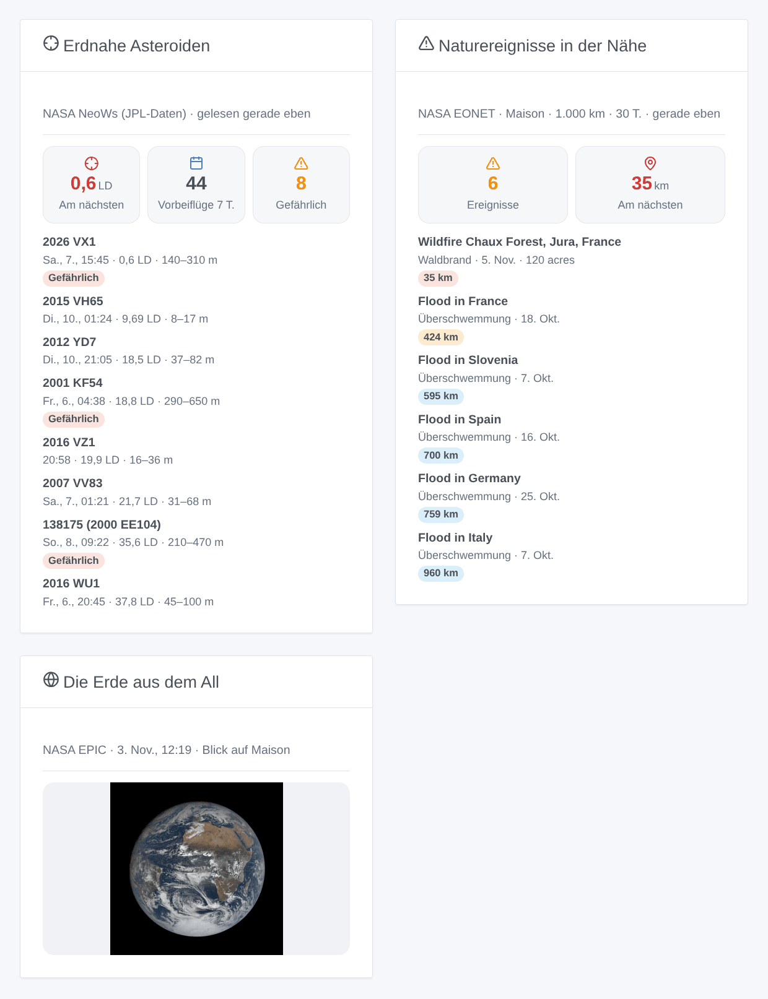

# NASA

## Überblick

Diese Integration bringt drei offene NASA-Dienste in Gladys: die **erdnahen Asteroiden**, die in den nächsten 7 Tagen vorbeifliegen (NeoWs, JPL-Daten), das neueste Bild der **ganzen Erde**, aufgenommen von der EPIC-Kamera des Satelliten DSCOVR in 1,5 Millionen km Entfernung, und die von EONET erfassten **Naturereignisse** in der Nähe deiner Zuhause: Waldbrände, schwere Stürme, Überschwemmungen, Vulkane, Meereis…

Transport: Cloud. Die Integration liest `api.nasa.gov`, `epic.gsfc.nasa.gov` und `eonet.gsfc.nasa.gov`. Sie sendet deinen NASA-Schlüssel, falls angegeben, nur an api.nasa.gov, und für EONET ein Quadrat mit dem gewählten Radius um jedes Zuhause mit Standort, nie seine genaue Position. Nicht mit der NASA verbunden.

**Der Mondabstand.** Die Entfernung von der Erde zum Mond, 384.400 km. Die meisten Asteroiden einer Woche fliegen jenseits von 5 Mondabständen vorbei; einige pro Jahr kommen innerhalb der Mondbahn vorbei. Ein **potenziell gefährlicher Asteroid** (PHA) ist größer als etwa 140 m und seine Bahn kommt der Erdbahn auf weniger als 7,5 Millionen km nahe: eine Einstufung, kein angekündigter Einschlag.

## Voraussetzungen

- Gladys 5.3.0 oder neuer (Widgets und Szenen-Auslöser).
- Für die Naturereignisse und die Erde mit Blick auf dein Zuhause: ein Zuhause mit Standort (Einstellungen → Zuhause). Die Integration fragt bei der Installation nach den Koordinaten der Zuhause.
- Optional: ein kostenloser NASA-API-Schlüssel, in einer Minute auf https://api.nasa.gov/ beantragt (eine E-Mail-Adresse genügt). Ohne ihn erlaubt der geteilte `DEMO_KEY` 10 Anfragen pro Stunde und IP-Adresse; die Integration braucht 4 am Tag.

## Konfiguration

| Feld                          | Verwendung                                                                                  |
| ----------------------------- | ------------------------------------------------------------------------------------------- |
| NASA-API-Schlüssel (optional) | Leer: `DEMO_KEY`. Ein eigener Schlüssel vermeidet ein mit deinem Netz geteiltes Kontingent. |
| Sprache der Texte             | Gerätenamen, Szenen-Sätze und Fehler. Automatisch: die Sprache des letzten Widgets.         |
| Radius um jedes Zuhause       | 100 bis 2.000 km (Standard 500): wie weit ein Naturereignis zählt.                          |
| Ereignisse der letzten        | 7, 14 oder 30 Tage (Standard 14).                                                           |
| Naher Vorbeiflug unter        | 1 bis 20 Mondabstände (Standard 5): Auslöser „naher Vorbeiflug“ und Widget-Farben.          |

Die Schaltfläche **Verbindung testen** liest die drei Dienste (die Asteroiden nur, wenn sie nicht in den letzten 10 Minuten gelesen wurden) und listet die Zuhause mit Standort auf. **Diagnose** schreibt den Zustand der Integration in ihre Protokolle, ohne Schlüssel und Koordinaten.

Die Integration liest die Asteroiden alle 6 Stunden, EPIC alle 3 Stunden (ein neuer Tag mit Bildern erscheint einmal am Tag, ein bis zwei Tage verspätet) und EONET jede Stunde. Ein Fehler lässt sie jedes Mal länger warten (höchstens 6 Stunden); ein aufgebrauchtes Kontingent wartet eine Stunde; ein abgelehnter Schlüssel wartet auf eine Änderung der Konfiguration.

## Verwendung

### Geräte

Im Bildschirm „Entdecken“: ein Gerät **Erdnahe Asteroiden (NASA)** und ein Gerät **Naturereignisse** pro Zuhause mit Standort. Erstelle die gewünschten.

| Gerät                     | Funktionen                                                                                                                                                                             |
| ------------------------- | -------------------------------------------------------------------------------------------------------------------------------------------------------------------------------------- |
| Erdnahe Asteroiden (NASA) | Nächster Vorbeiflug der kommenden 7 Tage (km und Mondabstände), Vorbeiflüge in 7 Tagen, potenziell gefährlich in 7 Tagen, Name des nächsten Asteroiden                                 |
| Naturereignisse – Zuhause | Anzahl der Ereignisse im Radius und Zeitraum, Abstand des nächsten (km), sein Titel, seine Kategorie und sein Abstand (ein Text). Ohne Ereignis behält der Abstand seinen letzten Wert |

### Dashboard-Widgets

- **Erdnahe Asteroiden**: der nächste Vorbeiflug (rot unter 1 Mondabstand, orange unter der Schwelle), die Zähler, dann die 8 nächsten oder kommenden Vorbeiflüge (Einstellung) mit Datum, Abstand und Größe; eine Zeile öffnet ihre Details und die JPL-Seite.
- **Die Erde aus dem All**: Wähle ein Gerät „Naturereignisse“ (leer: das erste Zuhause mit Standort): das neueste EPIC-Bild, dessen Mitte der Länge des Zuhauses am nächsten ist, mit seinem Datum.
- **Naturereignisse in der Nähe**: Wähle ein Gerät „Naturereignisse“: die Anzahl, der nächste Abstand und die Ereignisse mit Kategorie, Datum, Ausmaß und Quelle.

### Szenen

Auslöser (jeder kommt einmal, nie beim Start):

- **NASA: naher Vorbeiflug eines Asteroiden**: Ein Asteroid fliegt in den nächsten 7 Tagen näher als die Schwelle vorbei.
- **NASA: potenziell gefährlicher Asteroid**: Ein PHA fliegt in den nächsten 7 Tagen vorbei, egal wie weit.
- **NASA: Naturereignis in der Nähe**: ein neues EONET-Ereignis im Radius eines Zuhauses; Filter nach Zuhause und Kategorien. Eine Änderung von Radius oder Zeitraum löst die neu sichtbaren Ereignisse nie aus.

Jeder Auslöser liefert einen fertigen Satz, `{{triggerEvent.data.message}}`, in der Sprache der Konfiguration; die Titel der Ereignisse bleiben auf Englisch, wie die NASA sie schreibt.

Aktionen: **Asteroiden der Woche lesen**, **Naturereignisse in der Nähe lesen** (ein Zuhause), **neuestes Bild der Erde lesen** (ein Zuhause), jeweils mit einem Satz `summary`; die letzte liefert auch den Link des Bilds. Sie antworten mit den letzten Abfragen und lesen nur zu Altes neu.

Beispiele:

1. Wenn **naher Vorbeiflug eines Asteroiden** (Schwelle: 1 Mondabstand) → die Benachrichtigung `{{triggerEvent.data.message}}` senden.
2. Wenn **Naturereignis in der Nähe** am Gerät „Naturereignisse“ des Zuhauses, Kategorie Waldbrände → „Brand in {{triggerEvent.data.distance_km}} km: {{triggerEvent.data.title}}“ senden.
3. Jeden Sonntag um 9:00 → **Asteroiden der Woche lesen** → den `summary` senden.

## Fehlerbehebung

- **Kein Gerät „Naturereignisse“**: Das Zuhause hat keinen Standort (Einstellungen → Zuhause); danach im Bildschirm „Entdecken“ erneut suchen.
- **„api.nasa.gov lehnt den API-Schlüssel ab“**: Prüfe den Schlüssel oder leere das Feld für `DEMO_KEY`.
- **„Das Stundenkontingent von api.nasa.gov ist aufgebraucht“**: `DEMO_KEY` teilen sich alle Geräte deiner öffentlichen IP-Adresse; beantrage einen kostenlosen eigenen Schlüssel.
- **Die Naturereignisse bleiben bei 0**: EONET ist außerhalb der USA lückenhaft; versuche einen größeren Radius oder Zeitraum.
- **Das Bild der Erde ist ein paar Tage alt**: EPIC veröffentlicht seine Bilder ein bis zwei Tage verspätet und pausiert manchmal mehrere Tage.
- Protokolle: Einstellungen → Überwachung; füge im Entwicklermodus `DEBUG=gladys-integration-sdk` für die Protokolle des SDK hinzu. Issues: https://github.com/William-De71/gladys-nasa/issues
