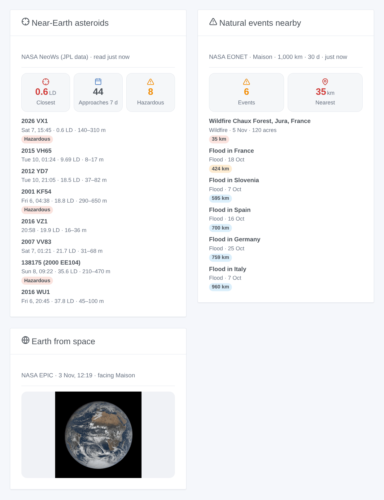

# NASA

## Overview

This integration brings three open NASA services into Gladys: the **near-Earth asteroids** that pass in the next 7 days (NeoWs, data of the JPL), the latest image of the **whole Earth** taken by the EPIC camera of the DSCOVR satellite, 1.5 million km away, and the **natural events** tracked by EONET near your houses: wildfires, severe storms, floods, volcanoes, sea ice…

Transport: cloud. The integration reads `api.nasa.gov`, `epic.gsfc.nasa.gov` and `eonet.gsfc.nasa.gov`. It sends your NASA key, if you gave one, to api.nasa.gov only, and for EONET a box of the chosen radius around each located house, never its exact position. Not affiliated with NASA.

**The lunar distance.** The distance from the Earth to the Moon, 384,400 km. Most asteroids of a week pass beyond 5 lunar distances; a few a year pass inside the orbit of the Moon. A **potentially hazardous asteroid** (PHA) is larger than about 140 m and its orbit comes within 7.5 million km of the Earth's: a classification, not an announced impact.

## Prerequisites

- Gladys 5.3.0 or later (widgets and scene triggers).
- For the natural events and the Earth facing your house: a house with a location (Settings → Houses). The integration asks for the coordinates of the houses at installation.
- Optional: a free NASA API key, requested in a minute on https://api.nasa.gov/ (an e-mail address is enough). Without it, the shared `DEMO_KEY` allows 10 requests an hour per IP address; the integration uses 4 a day.

## Configuration

| Field                    | Use                                                                                        |
| ------------------------ | ------------------------------------------------------------------------------------------ |
| NASA API key (optional)  | Empty: `DEMO_KEY`. A personal key avoids sharing a quota with other users of your network. |
| Language of the texts    | Device names, scene sentences and errors. Automatic: the language of the last widget.      |
| Radius around each house | 100 to 2,000 km (500 by default): how far a natural event counts.                          |
| Events of the last       | 7, 14 or 30 days (14 by default).                                                          |
| Close approach under     | 1 to 20 lunar distances (5 by default): the close approach trigger and widget colours.     |

The **Test the connection** button reads the three services (the asteroids only if they were not read in the last 10 minutes) and lists the located houses. **Diagnostic** writes the state of the integration to its logs, without the key nor the coordinates.

The integration reads the asteroids every 6 hours, EPIC every 3 hours (a new day of images is published once a day, one or two days late) and EONET every hour. A failure makes it wait longer each time (6 hours at most); an exhausted quota waits an hour; a refused key waits for a change of the configuration.

## Usage

### Devices

On the Discovery screen: a **Near-Earth asteroids (NASA)** device, and a **Natural events** device per located house. Create the ones you want.

| Device                      | Features                                                                                                                                                                     |
| --------------------------- | ---------------------------------------------------------------------------------------------------------------------------------------------------------------------------- |
| Near-Earth asteroids (NASA) | Closest approach of the next 7 days (km, and lunar distances), approaches in 7 days, potentially hazardous in 7 days, name of the closest asteroid                           |
| Natural events – house      | Number of events within the radius and the period, distance of the nearest (km), its title, category and distance (a text). With no event, the distance keeps its last value |

### Dashboard widgets

- **Near-Earth asteroids**: the closest approach (red under 1 lunar distance, orange under the threshold), the counts, then the 8 closest or next approaches (setting) with their date, distance and size; a row opens its details and its JPL page.
- **Earth from space**: choose a Natural events device (empty: the first located house): the latest EPIC image whose centre is the closest to the longitude of the house, with its date.
- **Natural events nearby**: choose a Natural events device: the count, the nearest distance, and the events with their category, date, magnitude and source.

### Scenes

Triggers (each fires once, never at startup):

- **NASA: close approach of an asteroid**: an asteroid will pass closer than the threshold in the next 7 days.
- **NASA: potentially hazardous asteroid**: a PHA will pass in the next 7 days, whatever its distance.
- **NASA: natural event nearby**: a new EONET event within the radius of a house; filter by house and by categories. Changing the radius or the period never fires the events that come into view.

Each trigger gives a ready-made sentence, `{{triggerEvent.data.message}}`, in the language of the configuration; the titles of the events stay in English, as NASA writes them.

Actions: **read the asteroids of the week**, **read the natural events nearby** (a house), **read the latest image of the Earth** (a house), each with a `summary` sentence; the last one also gives the link of the image. They answer from the last readings, and read again only what is too old.

Examples:

1. When **close approach of an asteroid** (threshold: 1 lunar distance) → send the notification `{{triggerEvent.data.message}}`.
2. When **natural event nearby** at the Natural events device of the house, categories Wildfires → send "Fire {{triggerEvent.data.distance_km}} km away: {{triggerEvent.data.title}}".
3. Every Sunday at 9:00 → **read the asteroids of the week** → send the `summary`.

## Troubleshooting

- **No Natural events device**: the house has no location (Settings → Houses), then run a scan from the Discovery screen.
- **"api.nasa.gov refuses the API key"**: check the key, or empty the field to use `DEMO_KEY`.
- **"The hourly quota of api.nasa.gov is used up"**: `DEMO_KEY` is shared by every device of your public IP address; ask for a free personal key.
- **The natural events stay at 0**: EONET is sparse outside the United States; try a larger radius or period.
- **The Earth image is a few days old**: EPIC publishes its images one or two days late, and sometimes pauses for days.
- Logs: Settings → Supervision; add `DEBUG=gladys-integration-sdk` in developer mode for the SDK logs. Issues: https://github.com/William-De71/gladys-nasa/issues
