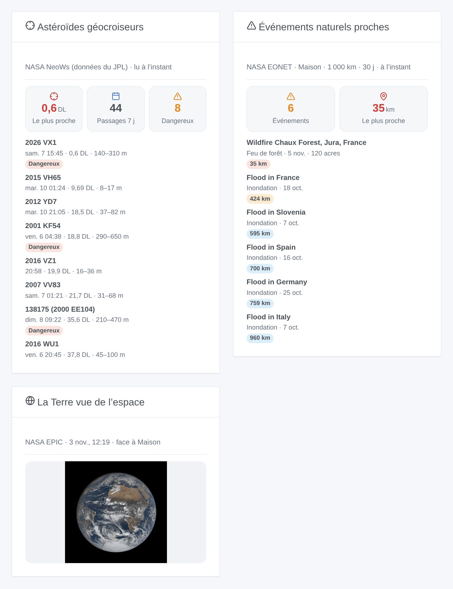

# NASA

## Présentation

Cette intégration apporte dans Gladys trois services ouverts de la NASA : les **astéroïdes géocroiseurs** qui passent ces 7 prochains jours (NeoWs, données du JPL), la dernière image de la **Terre entière** prise par la caméra EPIC du satellite DSCOVR, à 1,5 million de km, et les **événements naturels** suivis par EONET autour de vos maisons : feux de forêt, tempêtes violentes, inondations, volcans, glace de mer…

Transport : cloud. L’intégration lit `api.nasa.gov`, `epic.gsfc.nasa.gov` et `eonet.gsfc.nasa.gov`. Elle envoie votre clé NASA, si vous en avez donné une, à api.nasa.gov seulement, et pour EONET un carré du rayon choisi autour de chaque maison localisée, jamais sa position exacte. Non affiliée à la NASA.

**La distance lunaire.** La distance de la Terre à la Lune, 384 400 km. La plupart des astéroïdes d’une semaine passent au-delà de 5 distances lunaires ; quelques-uns par an passent à l’intérieur de l’orbite de la Lune. Un **astéroïde potentiellement dangereux** (PHA) mesure plus de 140 m environ et son orbite passe à moins de 7,5 millions de km de celle de la Terre : un classement, pas un impact annoncé.

## Prérequis

- Gladys 5.3.0 ou plus récent (widgets et déclencheurs de scène).
- Pour les événements naturels et la Terre face à votre maison : une maison localisée (Paramètres → Maisons). L’intégration demande les coordonnées des maisons à l’installation.
- Facultatif : une clé d’API gratuite de la NASA, demandée en une minute sur https://api.nasa.gov/ (une adresse e-mail suffit). Sans elle, la clé partagée `DEMO_KEY` permet 10 requêtes par heure et par adresse IP ; l’intégration en utilise 4 par jour.

## Configuration

| Champ                              | Rôle                                                                                          |
| ---------------------------------- | --------------------------------------------------------------------------------------------- |
| Clé d’API de la NASA (facultative) | Vide : `DEMO_KEY`. Une clé personnelle évite de partager un quota avec votre réseau.          |
| Langue des textes                  | Noms des appareils, phrases des scènes et erreurs. Automatique : la langue du dernier widget. |
| Rayon autour de chaque maison      | 100 à 2 000 km (500 par défaut) : jusqu’où un événement naturel compte.                       |
| Événements des derniers            | 7, 14 ou 30 jours (14 par défaut).                                                            |
| Passage proche à moins de          | 1 à 20 distances lunaires (5 par défaut) : déclencheur de passage proche et couleurs.         |

Le bouton **Tester la connexion** lit les trois services (les astéroïdes seulement s’ils n’ont pas été lus ces 10 dernières minutes) et liste les maisons localisées. **Diagnostic** écrit l’état de l’intégration dans ses journaux, sans la clé ni les coordonnées.

L’intégration lit les astéroïdes toutes les 6 heures, EPIC toutes les 3 heures (une nouvelle journée d’images est publiée une fois par jour, avec un ou deux jours de retard) et EONET toutes les heures. Un échec la fait attendre plus longtemps à chaque fois (6 heures au plus) ; un quota épuisé attend une heure ; une clé refusée attend un changement de la configuration.

## Utilisation

### Appareils

Dans l’écran Découverte : un appareil **Astéroïdes géocroiseurs (NASA)**, et un appareil **Événements naturels** par maison localisée. Créez ceux que vous voulez.

| Appareil                       | Fonctionnalités                                                                                                                                                                        |
| ------------------------------ | -------------------------------------------------------------------------------------------------------------------------------------------------------------------------------------- |
| Astéroïdes géocroiseurs (NASA) | Passage le plus proche des 7 prochains jours (km, et distances lunaires), passages sur 7 jours, potentiellement dangereux sur 7 jours, nom de l’astéroïde le plus proche               |
| Événements naturels – maison   | Nombre d’événements dans le rayon et la période, distance du plus proche (km), son titre, sa catégorie et sa distance (un texte). Sans événement, la distance garde sa dernière valeur |

### Widgets du tableau de bord

- **Astéroïdes géocroiseurs** : le passage le plus proche (rouge sous 1 distance lunaire, orange sous le seuil), les compteurs, puis les 8 passages les plus proches ou les prochains (réglage) avec leur date, leur distance et leur taille ; une ligne ouvre ses détails et la fiche du JPL.
- **La Terre vue de l’espace** : choisissez un appareil Événements naturels (vide : la première maison localisée) : la dernière image EPIC dont le centre est le plus proche de la longitude de la maison, avec sa date.
- **Événements naturels proches** : choisissez un appareil Événements naturels : le nombre, la distance du plus proche, et les événements avec leur catégorie, leur date, leur ampleur et leur source.

### Scènes

Déclencheurs (chacun part une seule fois, jamais au démarrage) :

- **NASA : passage proche d’un astéroïde** : un astéroïde passera plus près que le seuil dans les 7 prochains jours.
- **NASA : astéroïde potentiellement dangereux** : un PHA passera dans les 7 prochains jours, quelle que soit sa distance.
- **NASA : événement naturel proche** : un nouvel événement EONET dans le rayon d’une maison ; filtre par maison et par catégories. Changer le rayon ou la période ne déclenche jamais les événements qui entrent dans le champ.

Chaque déclencheur donne une phrase toute prête, `{{triggerEvent.data.message}}`, dans la langue de la configuration ; les titres des événements restent en anglais, comme la NASA les écrit.

Actions : **lire les astéroïdes de la semaine**, **lire les événements naturels proches** (une maison), **lire la dernière image de la Terre** (une maison), chacune avec une phrase `summary` ; la dernière donne aussi le lien de l’image. Elles répondent avec les dernières lectures, et ne relisent que ce qui est trop ancien.

Exemples :

1. Quand **passage proche d’un astéroïde** (seuil : 1 distance lunaire) → envoyer la notification `{{triggerEvent.data.message}}`.
2. Quand **événement naturel proche** à l’appareil Événements naturels de la maison, catégorie Feux de forêt → envoyer « Feu à {{triggerEvent.data.distance_km}} km : {{triggerEvent.data.title}} ».
3. Chaque dimanche à 9 h → **lire les astéroïdes de la semaine** → envoyer le `summary`.

## Dépannage

- **Aucun appareil Événements naturels** : la maison n’est pas localisée (Paramètres → Maisons), puis relancez une recherche depuis l’écran Découverte.
- **« api.nasa.gov refuse la clé d’API »** : vérifiez la clé, ou videz le champ pour utiliser `DEMO_KEY`.
- **« Le quota horaire d’api.nasa.gov est épuisé »** : `DEMO_KEY` est partagée par tous les appareils de votre adresse IP publique ; demandez une clé personnelle gratuite.
- **Les événements naturels restent à 0** : EONET est clairsemé hors des États-Unis ; essayez un rayon ou une période plus grands.
- **L’image de la Terre date de quelques jours** : EPIC publie ses images avec un ou deux jours de retard, et s’interrompt parfois plusieurs jours.
- Journaux : Paramètres → Supervision ; ajoutez `DEBUG=gladys-integration-sdk` en mode développeur pour les journaux du SDK. Issues : https://github.com/William-De71/gladys-nasa/issues
